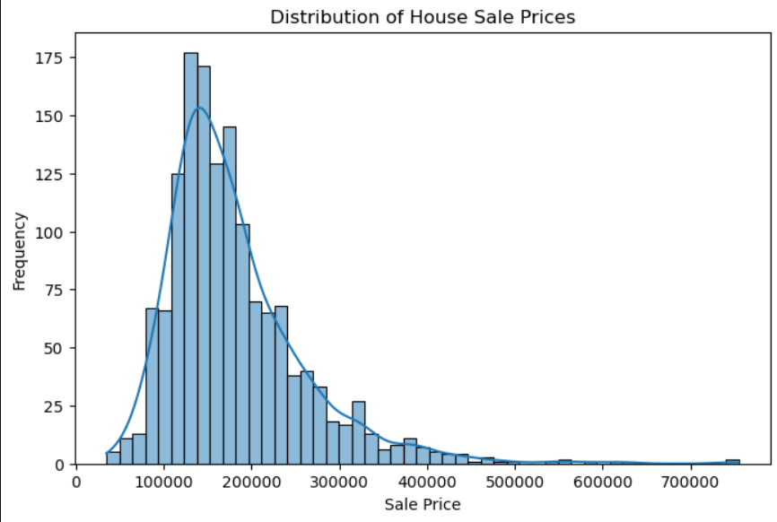
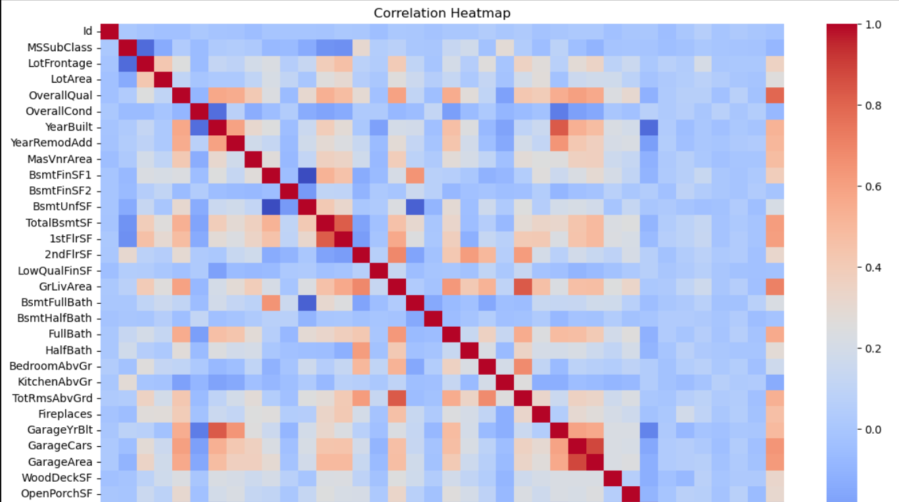
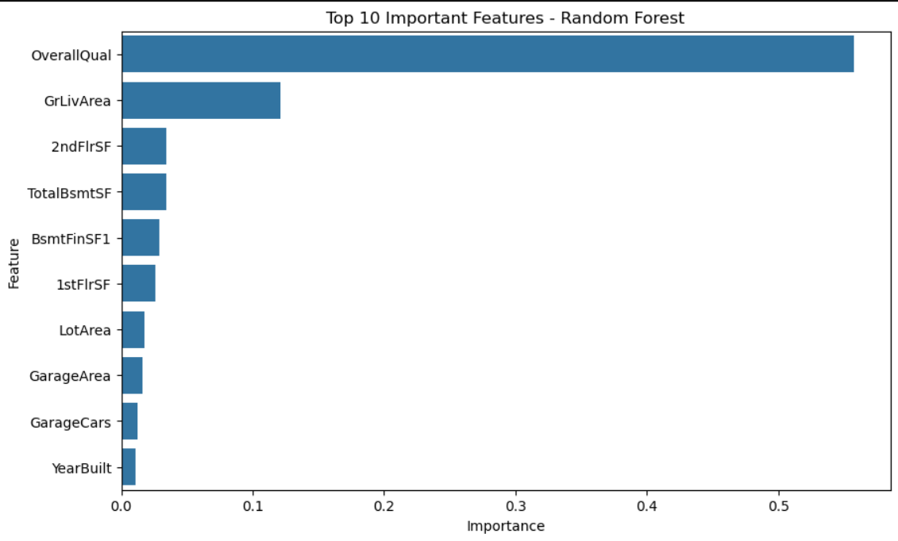
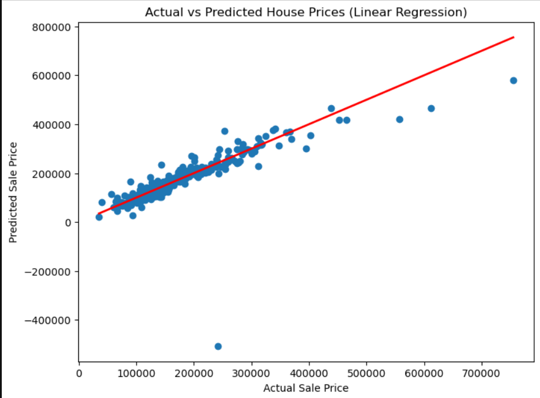

\# 🏡 House Price Prediction Using Machine Learning

\## 📌 Project Overview

This project focuses on analyzing residential housing data and developing machine learning regression models to predict house selling prices based on various property characteristics.

The project involves Exploratory Data Analysis (EDA), data preprocessing, feature engineering, regression model development, and performance evaluation to identify the most influential factors affecting house prices.

The objective is to help understand housing market trends and provide data-driven insights for potential home buyers and property sellers.

\## 🎯 Problem Statement

The objective is to develop a machine learning model that accurately predicts residential property selling prices using different housing features.

The project also aims to:

\- Identify the key factors influencing house prices.

\- Understand relationships between property characteristics and selling prices.

\- Compare different regression algorithms.

\- Provide useful recommendations for home buyers.

\## 📂 Dataset Description

The dataset contains residential property information with numerical and categorical features.

| Attribute | Details |

|---|---|

| Total Records | 1,460 |

| Total Columns | 81 |

| Numerical Features | 38 |

| Categorical Features | 43 |

| Target Variable | SalePrice |

| Duplicate Records | 0 |

The target variable `SalePrice` represents the actual selling price of each property.

\## 🔍 Exploratory Data Analysis (EDA)

Performed detailed exploratory data analysis to understand the dataset and identify important relationships.

### Sale Price Distribution

### Correlation Heatmap

### Feature Importance

### Actual vs Predicted Prices

Key analysis includes:

\- Sale Price Distribution

\- Correlation Analysis

\- Overall Quality vs Sale Price

\- Living Area vs Sale Price

\- Neighborhood vs Sale Price

\- Year Built vs Sale Price

\- Garage Capacity vs Sale Price

\- Missing Values Analysis

\### Key Insights

\- Overall Quality has a strong positive relationship with house prices.

\- Larger living areas generally correspond to higher selling prices.

\- Property location and neighborhood significantly influence market value.

\- Newer houses generally tend to have higher selling prices.

\- Garage capacity contributes to property value.

\## 🛠️ Data Preprocessing

The following preprocessing techniques were implemented:

\- Removed six features with excessive missing values.

\- Handled numerical missing values using Median Imputation.

\- Handled categorical missing values using Mode Imputation.

\- Checked for remaining missing values.

\- Prepared the dataset for machine learning.

\## ⚙️ Feature Engineering

Applied One-Hot Encoding using Pandas `get\\\_dummies()`.

\- Converted categorical variables into numerical representations.

\- Used `drop\\\_first=True` to avoid redundant dummy variables.

\- Increased the feature count from 75 to 231 after encoding.

\## 🤖 Machine Learning Models

Four regression algorithms were implemented and evaluated:

1\. Linear Regression

2\. Decision Tree Regressor

3\. Random Forest Regressor

4\. Gradient Boosting Regressor

The dataset was divided into training and testing sets using an 80:20 split.

\## 📊 Model Evaluation

The models were evaluated using three performance metrics:

\- \*\*MAE (Mean Absolute Error):\*\* Measures the average absolute difference between actual and predicted prices.

\- \*\*RMSE (Root Mean Squared Error):\*\* Measures prediction error while giving greater weight to larger errors.

\- \*\*R² Score:\*\* Measures how much variation in house prices is explained by the model.

\### Model Comparison Results

| Model | MAE | RMSE | R² Score |

|---|---:|---:|---:|

| Linear Regression | 20,384.19 | 51,992.05 | 0.648 |

| Decision Tree | 27,553.85 | 42,232.68 | 0.767 |

| Random Forest | 17,658.60 | 29,061.62 | 0.890 |

| \*\*Gradient Boosting\*\* | \*\*17,468.11\*\* | \*\*27,950.32\*\* | \*\*0.898\*\* |

\### 🏆 Best Performing Model

The Gradient Boosting Regressor achieved the best overall performance.

\- MAE: 17,468.11

\- RMSE: 27,950.32

\- R² Score: 0.898
The model explains approximately 89.8% of the variation in house prices on the test dataset.

Therefore, Gradient Boosting was selected as the final model.

⭐ Feature Importance

Random Forest feature importance analysis identified the following influential features:

Overall Quality (OverallQual)

Ground Living Area (GrLivArea)

Second Floor Area (2ndFlrSF)

Total Basement Area (TotalBsmtSF)

Basement Finished Area (BsmtFinSF1)

First Floor Area (1stFlrSF)

Lot Area (LotArea)

Garage Area (GarageArea)

Garage Capacity (GarageCars)

Year Built (YearBuilt)

Overall Quality was identified as the most influential feature in predicting house prices.

💡 Business Recommendations

Focus on improving the overall quality of residential properties.

Consider living area when evaluating property prices.

Pay attention to neighborhood and location when purchasing a house.

Maintaining and upgrading garages and basements can improve property value.

Consider construction year and property condition when estimating market prices.

🧰 Technologies Used

Python

Pandas

NumPy

Matplotlib

Seaborn

Scikit-learn

Jupyter Notebook

📁 Project Structure

House-Price-Prediction/

│

├── images/

│

├── data.csv

│

├── House Price Prediction.ipynb

│

├── README.md

│

└── requirements.txt

⚠️ Challenges Faced

Handling missing values across multiple features.

Converting categorical variables into numerical representations.

Identifying important features affecting house prices.

Comparing multiple regression algorithms.

Selecting the best-performing model using appropriate evaluation metrics.

📝 Conclusion

This project successfully demonstrates the application of machine learning techniques to residential house price prediction.

Through Exploratory Data Analysis, important factors influencing house prices were identified, including overall quality, living area, neighborhood, garage capacity, and construction year.

Four regression algorithms were developed and evaluated. Among them, the Gradient Boosting Regressor achieved the best performance with an R² Score of 0.898.

The project demonstrates how data analysis and machine learning can support real estate price estimation and data-driven decision-making.

Project Category: Machine Learning | Regression | Data Science

Author: Srivathsav

